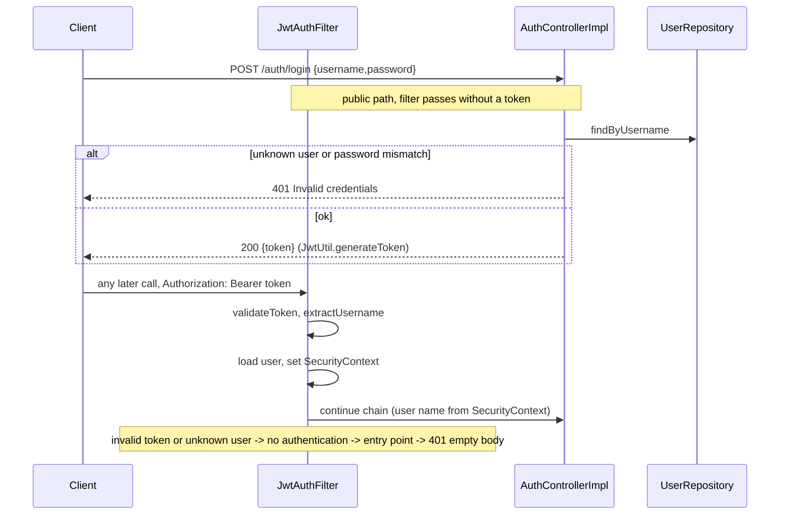

# Auth API

Users, passwords and JWTs. Errors: see [errors.md](errors.md). Schemas: `V1Credentials`, `V1AuthToken`, `V1CurrentUser` in the YAML.
Code: `controller/AuthControllerImpl.java` (no delegate or service: it talks to `IUserJpaRepository`, `PasswordEncoder`, `JwtUtil` directly), `security/`.

## Token model

| Item | Value |
|---|---|
| Algorithm | HS256, key from `JWT_SECRET` (min 32 chars, app fails to start otherwise) |
| Claims | `sub` = username, `iat`, `exp` |
| Lifetime | `app.jwt.expiration`, default `1h` |
| Refresh / server logout | none. The client discards the token; the UI logs out on any 401 |
| Revocation | none, except that a token for a deleted user is ignored (-> 401) |

## Register

- **Purpose:** create a user. **Contract:** `POST /auth/register`, public, body `{username, password}`, `200` text `User registered`.
- **Rules:** username and password must be non-blank (`.*\S.*`), otherwise `400` with `fieldErrors`. Duplicate username -> `400` plain text. No other password policy or length limit. Password stored with the `PasswordEncoder` hash. Registering does not log in.
- **Codes:** 200, 400.

## Login

- **Purpose:** exchange credentials for a JWT. **Contract:** `POST /auth/login`, public, same body, `200` `{token}`.
- **Rules:** unknown user and wrong password give the same `401 Invalid credentials` (no user enumeration). Same blank-field validation as register.
- **Codes:** 200, 400, 401.

## Me

- **Purpose:** return the authenticated username. **Contract:** `GET /auth/me`, JWT, `200` `{username}`.
- **Codes:** 200, 401.

## Flow

## Security rules (`SecurityConfig`)

| Rule | Detail |
|---|---|
| Public | `POST /auth/register`, `POST /auth/login`, `GET` of UI paths (`UiRoutes.PUBLIC_PATHS`: `/`, `/index.html`, `/assets/**`, `/favicon.*`, `/login`, `/register`, `/tasks`, `/tasks/**`) |
| Everything else | requires a valid JWT |
| CSRF | disabled (stateless bearer tokens) |
| Unauthenticated | `401` via `HttpStatusEntryPoint`, empty body |
| Current user in services | `IGetUserFromContextService` reads the name from `SecurityContext` and loads the `User` |

## Tests

`controller/ApiIntegrationTest`, `controller/UiAccessTest`, `security/JwtUtilTest`.
