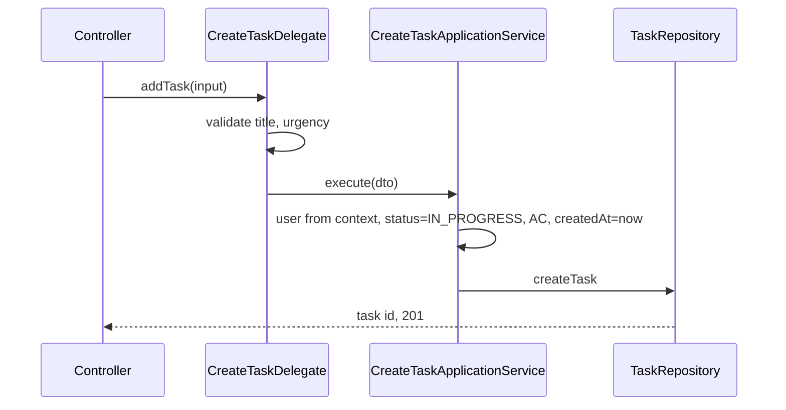
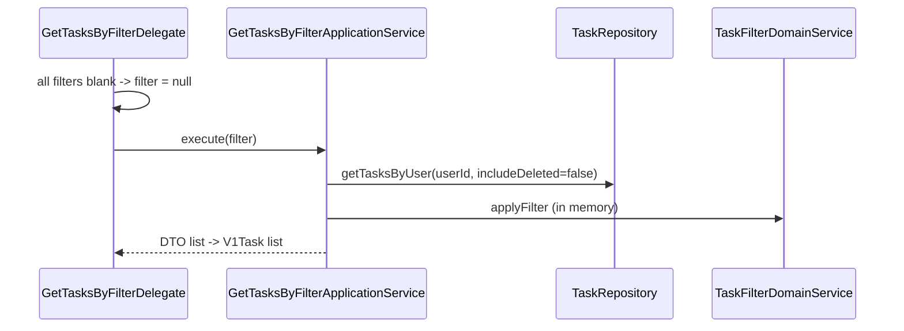
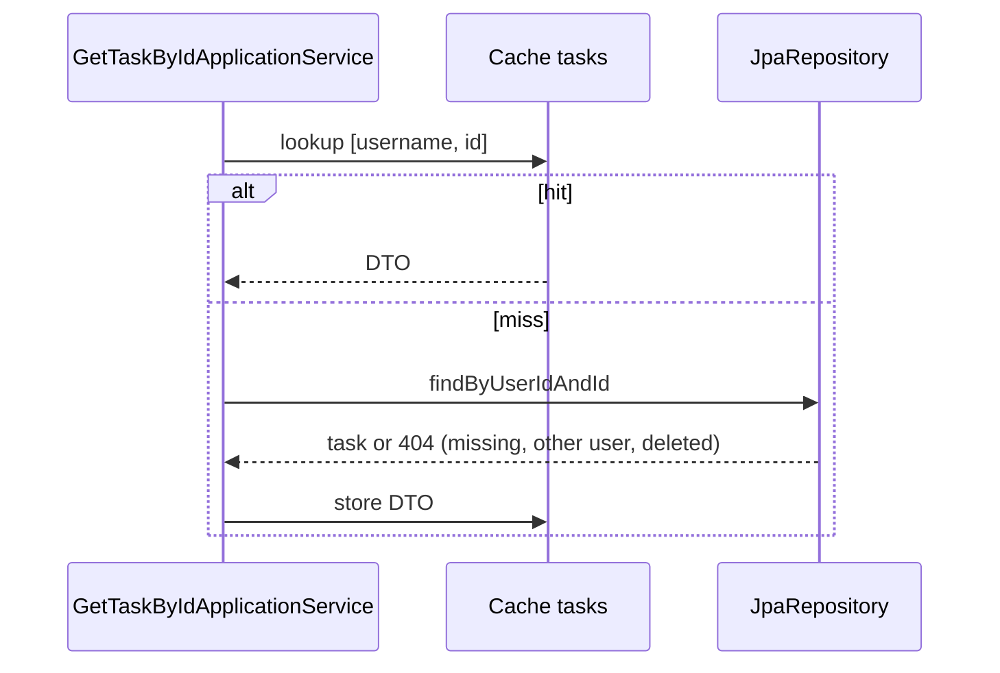
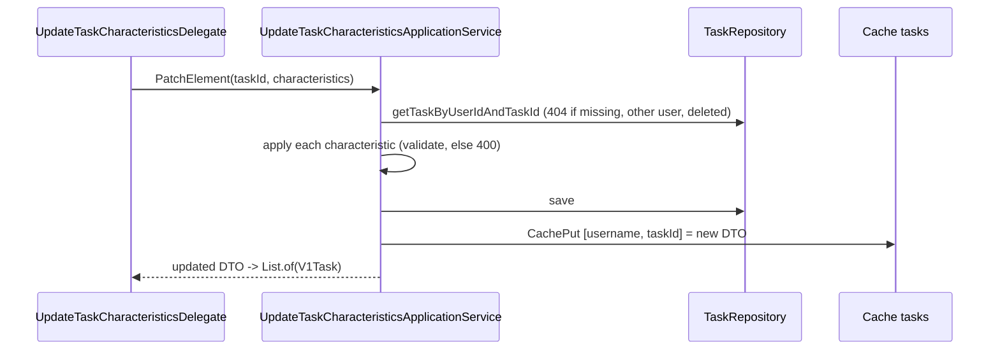
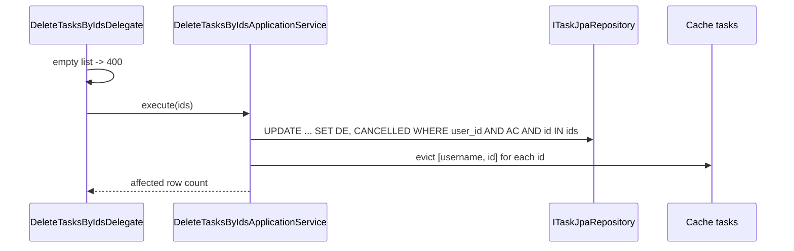

# Task API (`/task-management`)

All endpoints need a JWT and are scoped to the current user (every query filters by user id). Errors: [errors.md](errors.md). Schemas (`V1Task`, `V1CreateTaskInput`, `V1UpdateCharacteristicsInput`, `V1DeleteTaskInput`): the YAML.
Layering for every endpoint: `TaskControllerImpl` -> `*Delegate` (validation, mapping) -> `I*ApplicationService` (one per use case) -> repository. See [../architecture.md](../architecture.md).

## Data model

| Field | Type / values | Set by |
|---|---|---|
| id | Long (API: string) | database |
| userId | owner | server, from token |
| title | string, required on create | client |
| description | string, optional | client |
| urgency | `LOW` `NORMAL` `HIGH` | client, required on create |
| dueDate | ISO local date-time, optional | client |
| createdAt | local date-time | server = now on create; editable via update |
| status | `IN_PROGRESS` `COMPLETED` `CANCELLED` `SCHEDULED` | server = `IN_PROGRESS` on create; changed via update |
| activationStatus | `AC` active, `DE` deleted | server = `AC` on create; `DE` on delete |

Enum lists live in `business/constant/TaskConstants`; `TaskConstantsTest` keeps them equal to the YAML enums. There are no status transition rules: any valid status can be set from any other.

## Create

- **Purpose:** add a task. **Contract:** `POST /task-management`, body `{title, description?, urgency, dueDate?}`, `201` text/plain with the new id.
- **Rules:** empty title -> 400; missing or invalid urgency -> 400. Status, createdAt and activation are forced by the server; client values for them are ignored.
- **Codes:** 201, 400, 401.

## List

- **Purpose:** list own tasks. **Contract:** `GET /task-management?taskId=&status=&urgency=`, `200` array of `V1Task`.
- **Rules:** returns only active (`AC`) tasks of the user. Filters are optional, combined with AND, compared case-insensitively for equality. A non-matching or invalid filter value gives an empty list, not an error. No pagination, no sorting (the UI sorts). Not cached: reads the database each time.
- **Codes:** 200, 401.

## Get

- **Purpose:** one task by id. **Contract:** `GET /task-management/{taskId}`, `200` `V1Task`.
- **Rules:** `404` when the task does not exist, is soft-deleted, or belongs to another user. Non-numeric id -> 400. Cached per user and id.
- **Codes:** 200, 400, 401, 404.

## Update

- **Purpose:** change fields of one task. **Contract:** `PUT /task-management`, body `{taskId, characteristics: [{name, value}]}`, `200` array with exactly one `V1Task` (the updated one).
- **Rules:**

| name (case-insensitive) | value |
|---|---|
| TITLE, DESCRIPTION | any string |
| DUE_DATE | ISO local date-time (`2026-12-01T09:30`); empty/blank **clears** the date |
| CREATED_AT | ISO local date-time, required |
| URGENCY | `LOW` `NORMAL` `HIGH`, exact uppercase |
| STATUS | `IN_PROGRESS` `COMPLETED` `CANCELLED` `SCHEDULED`, exact uppercase |

  - Any other name, a bad date, or a value outside the enum -> 400. `activationStatus` and `userId` cannot be updated.
  - Missing/empty `taskId` or an empty `characteristics` list -> 400 (the id parse fails). Applied in order; characteristics apply to the entity before saving, and a thrown 400 means the entity is not saved.
  - Deleted, missing or other user's task -> 404.
- **Codes:** 200, 400, 401, 404.

## Delete

- **Purpose:** remove tasks. **Contract:** `DELETE /task-management`, body `{taskIds: ["1","2"]}`, `200` integer = number of tasks actually deleted.
- **Rules:** **soft delete**: sets `activationStatus=DE` and `status=CANCELLED`; rows are kept. Ids that are missing, already deleted or owned by someone else are silently skipped, so the count can be lower than the list size and no 404 is returned. Empty list -> 400. Non-numeric id -> 400. Cache entries for all given ids are evicted. Deleted tasks disappear from list and get (404).
- **Codes:** 200, 400, 401.

## Cache

| Item | Value |
|---|---|
| Cache | Caffeine `tasks`, max 5000 entries, expire 30 minutes after write (`CacheConfig`) |
| Key | `[username, taskId]` built only through `TaskCacheKeys` (never share entries between users) |
| Read | `@Cacheable` on get-by-id only |
| Write | `@CachePut` on update; explicit evict on delete |
| Not cached | list, create |
| Scope | in-process only; a second instance would not see evictions |

Keep all read and write paths consistent when adding any operation that changes a task.

## Code and tests

- Controller `controller/TaskControllerImpl`; delegates `resource/delegate/`; services `business/service/implementation/`; filter `business/domain/implementation/TaskFilterDomainService`; repositories `repository/service/`; output mapping `resource/mapper/`.
- Tests: `controller/ApiIntegrationTest` (HTTP codes), `business/*ApplicationServiceTest`, `business/TaskCacheTest`, `business/TaskConstantsTest`.
