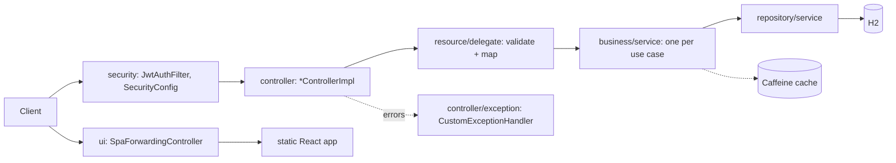
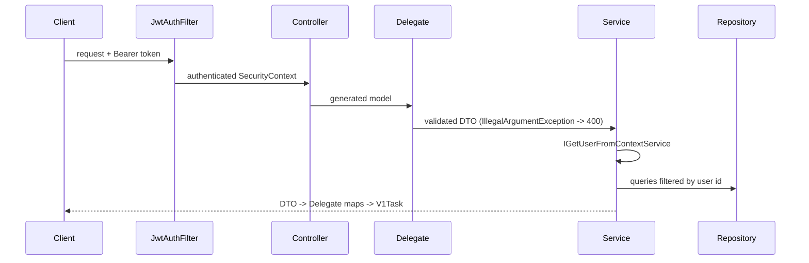

# Architecture

Layers, request flow, hosting, config. Endpoint behavior: [api/auth.md](api/auth.md), [api/tasks.md](api/tasks.md).

## Layers

Root package `com.todo`. Dependencies point inward-to-down only (controller -> delegate -> service -> repository). `com.todo.exception` may be used from any layer.

| Package | Contents |
|---|---|
| `controller/` | REST controllers implementing the generated interfaces; `exception/` handler; `api/task_management.yaml` (OpenAPI source of truth, generates `api/interfaces` and `api/model` at build) |
| `exception/` | `ResourceNotFoundException`, `UnauthorizedException` |
| `business/` | `service/` (interfaces `I*` + `implementation/`), `domain/` (filter logic), `model/` (DTOs, `Filter`, `PatchElement`, `Characteristic`), `cache/TaskCacheKeys`, `config/CacheConfig`, `constant/TaskConstants` |
| `resource/` | `delegate/` (input validation, request to DTO), `mapper/` (DTO to `V1Task`) |
| `repository/` | `entity/` (`Task`, `User`), `mapper/`, `service/` (JPA repositories and wrappers) |
| `security/` | `jwt/` (filter, util, properties, `SecurityConfig`), `service/` (user details), `config/` (password encoder) |
| `ui/` | `UiRoutes`, `SpaForwardingController` |

## Task request flow (generic)

## Where to add things

| Change | Do |
|---|---|
| New or changed endpoint | edit the YAML, implement the generated interface, add delegate + `I`-prefixed service, update docs/api |
| New task field | `Task` entity, `ITaskDTO`/`TaskDTO`, both mappers, YAML schemas, `UpdateTaskCharacteristicsApplicationService` if editable, `npm run api:generate`, docs/api/tasks.md |
| New exception | `com.todo.exception`, map in `CustomExceptionHandler`, add to api/errors.md |
| New client route | `UiRoutes` constant **and** `PUBLIC_PATHS`, plus the React router |
| New enum value | YAML, `TaskConstants` (`TaskConstantsTest` enforces equality), frontend model |

## Conventions

- Constructor injection with `private final` fields; `@Service` services, `@Component` delegates/mappers, `@Repository` repositories. `@Configuration` only for third-party beans (`CacheConfig`, `PasswordConfig`, `SecurityConfig`).
- Data objects (DTOs, `Filter`, `PatchElement`, `Characteristic`, entities) are created with `new`, not beans.
- Every task query filters by the current user's id.

## Persistence

H2 file database, `ddl-auto=update`. Tables: `app_user` (unique username, hashed password) and `task` (FK `user_id`; columns incl. `task_description`, `activation_status`). Deletes are soft (see api/tasks.md). H2 console at `/h2-console` (requires a JWT like any non-public path).

## Web UI

- `frontend/`: React + TypeScript + Vite + Redux Toolkit (RTK Query). Built into `target/classes/static` and served by the same jar.
- `src/api/generated.ts` is generated from the YAML (`npm run api:generate`), never edited by hand. `src/api/baseApi.ts` adds the bearer token and logs out on 401.
- Feature code: `src/features/auth`, `tasks`, `theme`; store in `src/app`. Colors via CSS variables in `src/index.css` (light/dark), no hard-coded colors.
- Client routes `/login`, `/register`, `/tasks/**` are forwarded to `index.html` by `SpaForwardingController`.

## Configuration

| Setting | Where | Note |
|---|---|---|
| `JWT_SECRET` | env | required, min 32 chars |
| `app.jwt.expiration` | `application.properties` | default `1h` |
| `spring.datasource.url` | `application.properties` | `/app/data/todo-db` (Docker path); override outside Docker; tests use in-memory H2 |
| `dev` profile | `application-dev.*` | `./data/todo-dev`, dev-only secret; never in production |

Build and run commands: see README and CLAUDE.md.
